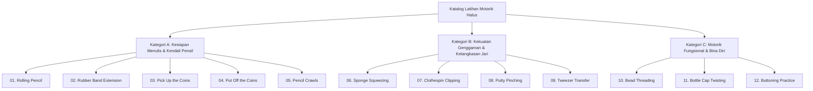
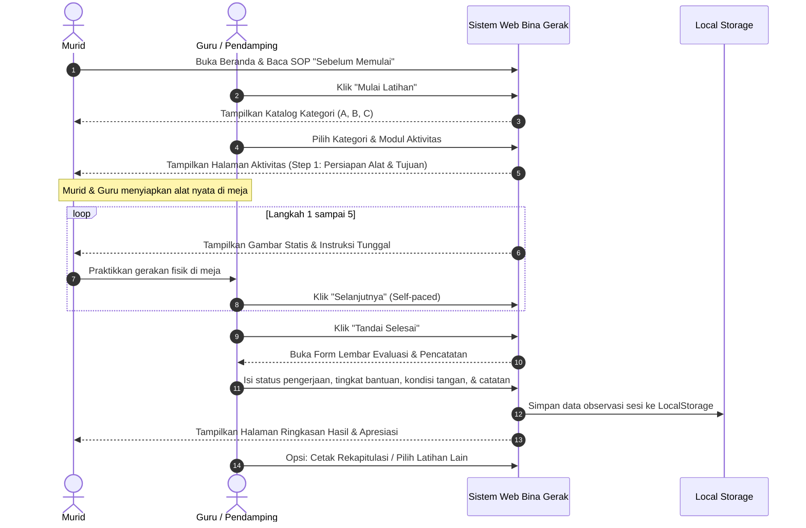

# PRODUCT REQUIREMENTS DOCUMENT (PRD)
## Platform Panduan Latihan Bina Gerak Motorik Halus Anggota Gerak Atas

---

| Dokumen | Product Requirements Document (PRD) |
| :--- | :--- |
| **Nama Produk** | Web Bina Gerak Motorik Halus (Bina Gerak Web) |
| **Versi** | 1.0.0 |
| **Status** | Final Draft / Ready for Implementation |
| **Target Rilis** | Q4 2026 |
| **Dokumen Acuan** | `Naskah_Lengkap_Website_Bina_Gerak_Motorik_Halus (1).docx` |
| **Bahasa Utama** | Bahasa Indonesia |

---

## 1. Ringkasan Eksekutif & Visi Produk

### 1.1 Visi Produk
Mewujudkan media panduan interaktif berbasis web yang ramah aksesibilitas dan adaptif untuk mendampingi latihan bina gerak motorik halus anggota gerak atas pada anak berkebutuhan khusus (khususnya murid dengan kondisi *Cerebral Palsy* atau hemiparesis/kelemahan unilateral). Web ini menjadi panduan visual terstruktur bagi murid dan instrumen observasi langsung bagi guru/pendamping dalam mengasah kesiapan menulis, ketangkasan jari, dan kemandirian bina diri (*Activities of Daily Living* / ADL).

### 1.2 Nilai Kunci (*Core Values*)
1. **Physical Activity Guidance (Bukan Game Layar):** Website bertindak sebagai pemandu instruksi visual; aktivitas motorik riil dilakukan sepenuhnya menggunakan objek/alat fisik di atas meja.
2. **Kognitif Ringan & Bertahap:** 1 instruksi per langkah (*single-step presentation*), bahasa konkret, tipografi ramah keterbacaan, dan navigasi ramah motorik.
3. **No-Distraction Media:** Tidak menggunakan video autoplay, audio latar wajib, atau animasi cepat yang memicu distraksi maupun spastisitas. Seluruh panduan visual berupa ilustrasi statis berkualitas tinggi dengan penunjuk arah gerak yang jelas.
4. **Teacher-Centric Evaluation:** Terintegrasi dengan panel pendamping/guru untuk mencatat tingkat bantuan (*prompting level*), respons fisik, kestabilan, dan tindak lanjut terapeutik secara real-time.

---

## 2. Analisis Masalah & Persona Pengguna

### 2.1 Latar Belakang Masalah
Berdasarkan hasil observasi pada murid kelas XI SMA usia 18 tahun dengan kondisi *Cerebral Palsy*, teridentifikasi karakteristik:
- Tangan kanan dominan dan fungsional, namun sisi kiri mengalami kelemahan (kebutuhan bantuan stabilisasi postur dan benda).
- Kesulitan dalam koordinasi jari halus (memanipulasi pensil, menjepit koin tipis, rotasi pergelangan).
- Memerlukan arahan visual terstruktur yang tidak menimbulkan kelelahan sensorik (*sensory overload*).
- Guru kesulitan mengukur kemajuan motorik secara terstandar tanpa lembar panduan dan pencatatan yang sistematis di dalam kelas.

### 2.2 Persona Pengguna

```
+--------------------------------------------------------------------------------------------------+
| PERSONA 1: SISWA / MURID                                                                         |
| Nama Profil       : Murid Kebutuhan Khusus / Cerebral Palsy (contoh: usia 15-18 tahun)           |
| Peran             : Pengguna Utama Panduan Visual                                                |
| Kebutuhan         : Tampilan visual berukuran besar, kontras tinggi, instruksi sangat singkat,   |
|                     kontrol navigasi mudah ditekan/disentuh, langkah yang tidak terburu-buru.    |
| Kendala           : Tremor ringan/spastisitas, rentang perhatian terbatas pada teks panjang,     |
|                     kelemahan satu sisi anggota gerak (unilateral weakness).                     |
+--------------------------------------------------------------------------------------------------+
| PERSONA 2: GURU PENDAMPING / TERAPIS / ORANG TUA                                                 |
| Nama Profil       : Guru SLB / Guru Pendamping Khusus (GPK) / Terapis Okupasi                    |
| Peran             : Fasilitator, Supervisor Keselamatan, & Evaluator Observasi                   |
| Kebutuhan         : Panduan penyiapan alat, catatan penyesuaian/adaptasi fisik, form observasi   |
|                     langsung (tingkat bantuan & kondisi tangan), serta rekapitulasi sesi.        |
| Kendala           : Waktu administrasi terbatas, membutuhkan pencatatan cepat tanpa mengganggu   |
|                     proses interaksi dengan murid di meja belajar.                              |
+--------------------------------------------------------------------------------------------------+
```

---

## 3. Cakupan Produk & Batasan (*Scope & Boundaries*)

### 3.1 Fitur Dalam Cakupan (*In-Scope*)
- **Halaman Beranda:** Pengantar program, checklist SOP keselamatan ("Sebelum Memulai"), tombol Mulai Latihan, panduan singkat.
- **Katalog 3 Kategori & 12 Modul Aktivitas Latihan Motorik Halus:**
  - Kategori A: Kesiapan Menulis & Kendali Pensil (5 modul)
  - Kategori B: Kekuatan Genggaman & Ketangkasan Jari (4 modul)
  - Kategori C: Motorik Fungsional & Bina Diri (3 modul)
- **Halaman Wizard Latihan Per-Langkah (*Step-by-Step Exercise Stepper*):**
  - Daftar alat yang disiapkan.
  - Ilustrasi statis posisi tangan dan alat dengan arah gerak visual.
  - Instruksi teks per-langkah bernomor (fokus 1 instruksi per tayangan).
  - Kontrol navigasi besar: "Sebelumnya", "Selanjutnya", "Kembali ke Kategori", dan "Selesai".
- **Panel Khusus Guru/Pendamping (*Drawer / Collapsible Panel*):**
  - Panduan penyesuaian/adaptasi fisik per modul.
  - Aspek pengamatan klinis yang perlu dipantau.
- **Formulir Pencatatan Evaluasi Sesi Selesai (*Evaluation Sheet*):**
  - Skala Tingkat Bantuan (*Independent, Visual Prompt, Verbal Prompt, Physical Assistance*).
  - Ketepatan Gerakan (*Baik, Berkembang, Perlu Bantuan Lanjut*).
  - Kondisi Tangan (*Nyaman, Lelah, Tidak Nyaman, Nyeri*).
  - Catatan observasi guru & Rekomendasi tindak lanjut.
- **Halaman Ringkasan Hasil & Penutup Sesi:**
  - Kalimat afirmasi positif.
  - Rekap modul yang telah dikerjakan.
  - Opsi simpan lokal (*LocalStorage*) dan cetak/ekspor lembar evaluasi (Print/PDF).
- **Standar Aksesibilitas WCAG 2.1 AA:** Target sentuh >= 48px, rasio kontras warna tinggi, navigasi keyboard penuh, teks alternatif lengkap.

### 3.2 Batasan (*Out-of-Scope*)
- **Tidak ada pemutaran video:** Format visual mutlak foto/ilustrasi vektor statis.
- **Bukan Touchscreen Drag & Drop Game:** Siswa tidak melakukan drag-and-drop benda virtual di layar; semua gerakan memakai benda nyata di meja.
- **Tidak menggantikan asesmen medis profesional:** Platform tidak mengeluarkan diagnosis medis otomatis; hanya instrumen bantu pencatatan observasi perilaku motorik.
- **Tanpa timer mundur yang memaksa (*No auto-timeout*):** Siswa dan guru memegang kontrol penuh atas kecepatan pengerjaan (*self-paced*).

---

## 4. Taksonomi Konten: 3 Kategori & 12 Aktivitas



### 4.1 Matriks Detail 12 Aktivitas

| No | Modul | Kategori | Alat Fisik | Tujuan Spesifik | Catatan Penyesuaian Guru | Aspek yang Diamati |
| :---: | :--- | :---: | :--- | :--- | :--- | :--- |
| **01** | **Rolling Pencil** *(Menggulingkan Pensil)* | A | 1 batang pensil bulat nyaman digenggam | Mengembangkan kontrol jari saat mengubah posisi pensil | Mulai dari pergeseran kecil atau pensil berdiameter lebih tebal; stabilkan lengan bawah bila perlu. | Kestabilan genggaman, arah gerakan rotasi, pensil jatuh/tidak, tingkat bantuan. |
| **02** | **Rubber Band Extension** *(Membuka Jari dg Karet)* | A | Karet elastis resistansi sangat ringan & ukuran pas | Melatih gerakan membuka jari terarah dengan tahanan ringan | **PENTING:** Jika ada nyeri, tekanan berlebih, jari pucat/kebiruan, hentikan segera. Ganti buka jari tanpa tahanan. | Rentang gerak yang nyaman, kelancaran buka-tutup jari, tanda ketidaknyamanan. |
| **03** | **Pick Up the Coins** *(Mengambil Koin)* | A | Beberapa koin/keping pipih aman, alas antiselip | Melatih jepitan pincer & memindahkan benda meja ke telapak | Gunakan keping lebih besar/tebal jika koin tipis sulit dijepit. Jumlah keping disesuaikan. | Ketepatan menjepit (*pincer grasp*), keberhasilan mengangkat, koordinasi, bantuan. |
| **04** | **Put Off the Coins** *(Melepas Koin Bertahap)* | A | Koin/keping aman & wadah stabil | Pemindahan intra-tangan (*palm to fingertip*) & pelepasan terarah | Awali dari 1-2 keping jika koordinasi telapak tangan sulit. Guru bantu memosisikan keping. | Kemampuan manipulasi 1 tangan, separasi gerak jari, kontrol pelepasan benda. |
| **05** | **Pencil Crawls** *(Merayapkan Jari di Pensil)* | A | 1 pensil bertekstur tidak licin | Melatih pengaturan genggaman sepanjang batang pensil | Gunakan pensil tebal / pencil grip. Jangan paksakan pola genggaman tertentu. | Kemampuan menggeser jari naik-turun, kestabilan batang pensil, bantuan fisik. |
| **06** | **Sponge Squeezing** *(Meremas Spons)* | B | Spons bersih lembut seukuran genggaman | Menggenggam & melepas benda lunak secara terkendali | Pilih spons lebih empuk/besar. Hindari perasan kencang jika memicu spastisitas/nyeri. | Bentuk genggaman (*power grasp*), kontrol pelepasan, tanda kelelahan otot. |
| **07** | **Clothespin Clipping** *(Menjepit Penjepit Baju)* | B | Penjepit jemuran per ringan, karton tebal/papan stabil | Menjepit bertekanan & melepas pada media | Gunakan penjepit ringan; posisikan karton stabil di meja (bisa direkatkan/ditahan). | Kontrol jepitan jempol-telunjuk, ketepatan menempatkan pada tepi, stabilisasi. |
| **08** | **Putty Pinching** *(Mencubit Plastisin Lunak)* | B | Plastisin / playdough / putty lunak & bersih | Melatih kekuatan & presisi ujung jari (*pinch*) | Gunakan bahan lebih lunak. Hindari adonan yang terlalu lengket atau alot. | Kontrol ujung jari, kekuatan cubitan, pembentukan bentuk bulatan/pipih. |
| **09** | **Tweezer Transfer** *(Pindah Benda dg Penjepit)* | B | Penjepit tumpul ringan, pom-pom/benda kecil, 2 wadah | Koordinasi mata-tangan alat jepit mekanik | Gunakan penjepit jumbo atau objek yang lebih besar jika kontrol motorik terbatas. | Tekanan capit, ketepatan menjepit & memindahkan antar wadah tanpa terjatuh. |
| **10** | **Bead Threading** *(Meronce Manik-Manik)* | C | Manik-manik lubang besar, tali dengan ujung kaku | Koordinasi bilateral dua tangan dalam tugas fungsional | Gunakan tali kaku (atau ujung berselotip) & alas stabil. Tangan kiri memegang tali, kanan meronce. | Ketepatan memasukkan lubang, kerja sama kedua tangan, koordinasi bilateral. |
| **11** | **Bottle Cap Twisting** *(Memutar Tutup Botol)* | C | Botol plastik stabil, tutup lebar, alas antiselip | Rotasi pergelangan/jari untuk kemandirian makan-minum | Gunakan tutup botol besar tidak terlalu rapat. Tangan nondominan menahan botol. | Koordinasi bilateral, arah rotasi buka/tutup, kekuatan cengkeraman, nyeri pergelangan. |
| **12** | **Buttoning Practice** *(Latihan Mengancing Baju)* | C | Papan kancing / kemeja berkancing besar | Manipulasi jari saat berpakaian (bina diri) | Awali dari kancing diameter besar dan lubang longgar. Stabilkan kain di meja. | Ketepatan koordinasi jempol-telunjuk, menyelipkan kancing, kemandirian. |

---

## 5. Kebutuhan Fungsional (*Functional Requirements*)

### 5.1 Alur Pengguna Utama (*Main User Flow*)



### 5.2 Spesifikasi Detail Modul

#### FR-01: Modul Beranda & Orientasi Awal
- **FR-01.1 Teks Identitas:** Menampilkan Judul: *"Latihan Motorik Halus Anggota Gerak Atas"*, Subjudul: *"Ayo latih gerakan tangan dan jari melalui kegiatan sehari-hari"*, Tagline: *"Lihat gambarnya. Ikuti langkahnya. Coba gerakannya."*
- **FR-01.2 Penjelasan Program:** Ringkasan bahwa panduan ini untuk latihan nyata dengan benda fisik, didampingi guru.
- **FR-01.3 Checklist "Sebelum Memulai":**
  1. Duduk dengan posisi yang nyaman dan stabil.
  2. Pastikan meja serta alat latihan sudah siap.
  3. Gunakan tangan yang paling mampu melakukan gerakan; bantuan untuk tangan lainnya diberikan bila sesuai.
  4. Lakukan gerakan perlahan. Berhenti jika terasa sakit atau tidak nyaman.
  5. Ikuti satu langkah sampai selesai sebelum berpindah ke langkah berikutnya.
- **FR-01.4 Navigasi Utama:** Tombol *"Mulai Latihan"* (menuju Katalog Kategori) dan tombol *"Panduan Guru"*.

#### FR-02: Modul Katalog Kategori & Aktivitas
- **FR-02.1 Filter/Kategori Latihan:** 3 tab/kartu kategori (Kategori A, B, C) dengan deskripsi manfaat masing-masing.
- **FR-02.2 Daftar Kartu Latihan:** 12 kartu interaktif yang menampilkan nomor urut, judul bahasa Inggris & Indonesia, ringkasan manfaat 1 baris, badge alat, dan status penyelesaian hari ini.
- **FR-02.3 Fleksibilitas Urutan:** Guru bebas memilih urutan latihan mana pun sesuai kebutuhan individual murid (tidak terkunci linear).

#### FR-03: Modul Halaman Latihan (*Interactive Exercise Stepper*)
- **FR-03.1 Struktur Seragam per Latihan:**
  - Header: Kategori, Nomor Modul, Nama Latihan.
  - Tujuan Aktivitas: Kalimat singkat kemampuan yang dilatih.
  - Alat yang Disiapkan: Daftar alat fisik konkret.
  - Panel Visual: Gambar ilustrasi statis dengan tanda panah gerak jelas, kontras tinggi, dilengkapi `alt` text.
  - Stepper Instruksi: Menampilkan langkah bernomor (1 s.d. 5). Hanya langkah aktif yang diberi highlight teks besar (24px+).
  - Peringatan Khusus Keselamatan (*Safety Banner*): Tampil mencolok pada aktivitas berisiko tahanan (*Rubber Band*, *Bottle Cap*).
- **FR-03.2 Navigasi Langkah:**
  - Tombol *"Sebelumnya"* (Disabled di langkah 1).
  - Tombol *"Selanjutnya"* (Berpindah ke langkah berikutnya).
  - Tombol *"Selesai"* (Aktif pada langkah 5 atau setelah seluruh langkah dilalui).
  - Tombol *"Kembali ke Kategori"*.

#### FR-04: Panel Khusus Guru/Pendamping (*Collapsible Teacher Drawer*)
- **FR-04.1 Akses Mudah:** Tombol *"Catatan Pendamping"* yang dapat dibuka/tutup di bagian samping/bawah halaman latihan tanpa menutupi instruksi murid.
- **FR-04.2 Konten Penyesuaian:** Trik adaptasi (misal modifikasi alat, penopang tangan, penyesuaian sudut).
- **FR-04.3 Aspek Pengamatan:** Checklist hal yang harus diobservasi secara visual (kestabilan sendi, tremor, kompensasi otot bahu/leher, rasa lelah).

#### FR-05: Modul Lembar Observasi & Evaluasi Sesi
- **FR-05.1 Pemicu (*Trigger*):** Muncul otomatis saat tombol *"Selesai"* dikonfirmasi oleh guru.
- **FR-05.2 Input Identitas Sesi:**
  - Tanggal & Waktu (Otomatis terisi waktu sistem).
  - Kode Murid (Input teks pendek, default: "Siswa-01").
  - Nama Pendamping (Input teks pendek).
- **FR-05.3 Rubrik Penilaian Terstandar:**
  - *Tugas Dilakukan:* Radio button `[ Ya | Sebagian | Belum ]`
  - *Tingkat Bantuan:* Radio button `[ Mandiri | Petunjuk Visual | Petunjuk Verbal | Bantuan Fisik ]`
  - *Ketepatan Gerakan:* Radio button `[ Baik | Berkembang | Perlu Bantuan Lebih Lanjut ]`
  - *Kondisi Tangan:* Radio button `[ Nyaman | Lelah | Tidak Nyaman | Nyeri ]`
  - *Catatan Observasi:* Textarea untuk observasi bebas guru.
  - *Rekomendasi Tindak Lanjut:* Dropdown / Radio button `[ Ulangi | Sederhanakan | Lanjutkan | Hentikan & Evaluasi ]`
- **FR-05.4 Aksi Penyimpanan:** Tombol *"Simpan Hasil & Selesai"* memvalidasi form, menyimpan ke penyimpanan lokal, dan mengarahkan ke halaman penutup.

#### FR-06: Modul Ringkasan Hasil & Apresiasi Penutup
- **FR-06.1 Afirmasi Positif:** Teks sambutan *"Latihan Hari Ini Selesai! Terima kasih sudah berlatih..."* atau alternatif jika belum selesai: *"Tidak apa-apa jika latihan belum selesai. Yang penting gerakan dilakukan dengan aman dan nyaman."*
- **FR-06.2 Rekapitulasi Sesi:** Daftar modul yang telah dikerjakan, status pengerjaan, dan ringkasan catatan guru.
- **FR-06.3 Tombol Tindakan:**
  - *"Kembali ke Beranda"*
  - *"Pilih Latihan Lain"*
  - *"Cetak / Simpan Catatan (Print / PDF)"* (Memicu print preview dengan CSS cetak yang rapi dan profesional).

---

## 6. Kebutuhan Non-Fungsional (*Non-Functional Requirements*)

### 6.1 Aksesibilitas (WCAG 2.1 Level AA)
- **Rasio Kontras Warna:** Minimal 4.5:1 untuk teks normal dan 3:1 untuk elemen UI/teks besar.
- **Ukuran Target Sentuh:** Tombol dan elemen interaktif minimal 48x48 piksel, dengan *padding* dan *margin* aman.
- **Navigasi Keyboard:** Dukungan `Tab`, `Shift+Tab`, `Enter`, `Space` pada semua kontrol, dengan indikator fokus visual tebal (`outline: 3px solid #0056b3; outline-offset: 2px`).
- **Screen Reader Support:** Menggunakan elemen HTML5 semantik (`<main>`, `<header>`, `<nav>`, `<article>`, `<button>`), atribut `aria-live="polite"` saat langkah latihan berganti, serta `aria-expanded` pada drawer guru.
- **Bebas Distraksi Sensorik:** Tidak ada elemen berkedip, tidak ada audio otomatis yang mengagetkan, tidak ada animasi transisi berkecepatan tinggi (*prefers-reduced-motion* didukung).

### 6.2 Performa & Keandalan (*Performance*)
- Waktu muat halaman pertama (*First Contentful Paint*) < 1.2 detik pada jaringan 3G/4G standar.
- Beroperasi secara lokal (*client-side first*) tanpa latensi jaringan yang menghambat pergantian langkah.
- Tidak bergantung pada library eksternal berukuran besar.

### 6.3 Privasi & Perlindungan Data (*Data Privacy*)
- Zero PII (*Personally Identifiable Information*): Tidak meminta data sensitif seperti nomor induk kependudukan atau rekam medis resmi.
- Data evaluasi tersimpan aman di browser lokal pengguna (*LocalStorage*), dengan opsi reset data atau ekspor mandiri oleh guru.

---

## 7. Metrik Keberhasilan & Kriteria Penerimaan (*Acceptance Criteria*)

| ID | Fitur | Kriteria Penerimaan (*Acceptance Criteria*) |
| :--- | :--- | :--- |
| **AC-01** | Navigasi Langkah | Murid/guru dapat berpindah langkah 1 s.d. 5 dan kembali tanpa hilangnya konteks latihan. |
| **AC-02** | Zero Video | Tidak ada elemen `<video>` atau iframe streaming yang disematkan; hanya gambar ilustrasi statis. |
| **AC-03** | Form Evaluasi | Guru dapat memilih 4 kriteria rubrik utama, menuliskan catatan, dan data tersimpan di LocalStorage dengan format JSON valid. |
| **AC-04** | Ekspor / Cetak | Saat menekan "Cetak Catatan", browser membuka dialog print dengan layout bersih tanpa tombol navigasi web yang mengganggu. |
| **AC-05** | Aksesibilitas | Lulus audit Lighthouse Accessibility dengan skor >= 95; seluruh tombol utama dapat dioperasikan via keyboard. |
