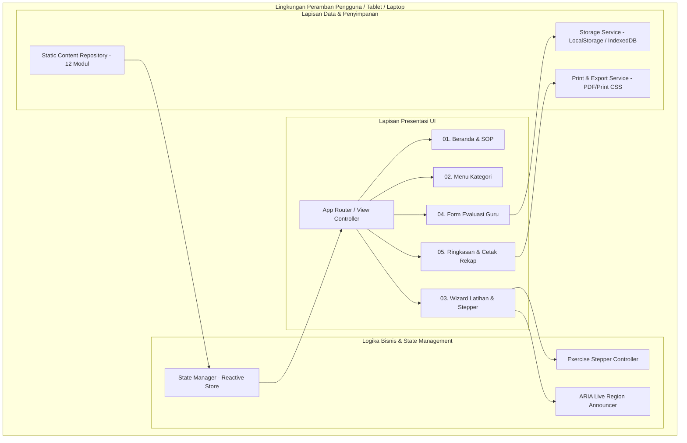
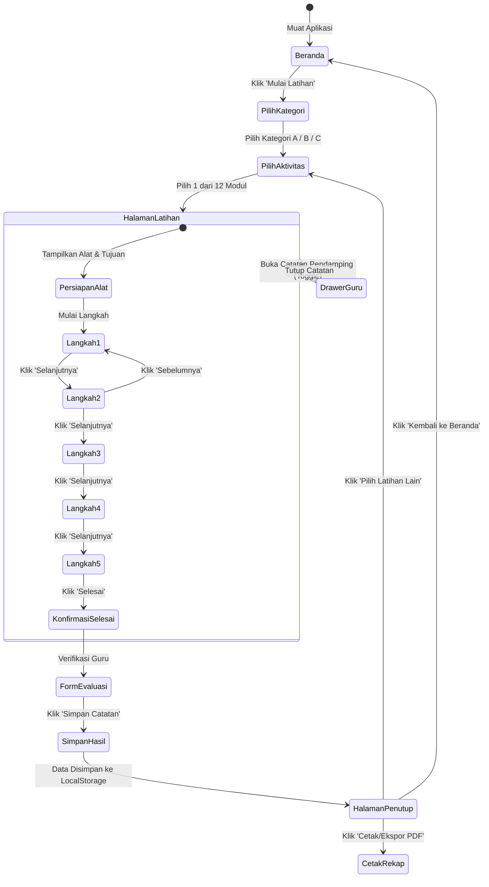

# SOFTWARE DESIGN DOCUMENT (SDD)
## Platform Panduan Latihan Bina Gerak Motorik Halus Anggota Gerak Atas

---

| Dokumen | Software Design Document (SDD) |
| :--- | :--- |
| **Nama Sistem** | Web Panduan Bina Gerak Motorik Halus |
| **Versi Dokumen** | 1.0.0 |
| **Status** | Approved for Development |
| **Target Rilis** | Q4 2026 |
| **Dokumen Terkait** | `PRD_Bina_Gerak_Motorik_Halus.md` & `Naskah_Lengkap_Website_Bina_Gerak_Motorik_Halus (1).docx` |
| **Arsitektur Utama**| Client-Side Single Page Application (SPA) / Progressive Web App (PWA) |

---

## 1. Pendahuluan & Sasaran Teknis

### 1.1 Tujuan Dokumen
Dokumen Desain Perangkat Lunak (*Software Design Document* - SDD) ini merinci arsitektur teknis, desain komponen, struktur data, antarmuka pengguna, serta integrasi sistem untuk Platform Web Bina Gerak Motorik Halus. Dokumen ini menjadi pedoman baku bagi perekayasa perangkat lunak (*software engineers*) dalam mengimplementasikan aplikasi sesuai dengan spesifikasi pada *Product Requirements Document* (PRD).

### 1.2 Sasaran Teknis Inti (*Core Engineering Goals*)
1. **Zero-Latency Navigation:** Transisi langkah latihan (*stepper*) terjadi seketika di peramban tanpa jeda pemanggilan jaringan (*client-side reactive rendering*).
2. **Accessible by Design (WCAG 2.1 AA):** Desain sistem berbasis token semantik, kontrol keyboard penuh, ukuran target sentuh minimal 48px, dan kontras warna terkalibrasi.
3. **Local-First & Offline Resilience:** Aplikasi dapat berjalan tanpa koneksi internet (*offline-capable*) menggunakan Service Worker dan *LocalStorage* peramban, menjaga privasi data observasi siswa.
4. **Zero Heavy Media:** Arsitektur tanpa pemutar video (*no video players*); aset grafis berupa gambar statis SVG/WebP beresolusi tinggi dengan penunjuk arah gerak vektor.

---

## 2. Arsitektur Sistem Global (*System Architecture*)

### 2.1 Topologi Sistem
Aplikasi dirancang menggunakan paradigma **Client-Side First (Local-First Single Page Application)**. Seluruh logika katalog aktivitas, pemandu langkah latihan, dan pencatatan evaluasi berjalan langsung pada perangkat pengguna (*browser*).



### 2.2 Tumpukan Teknologi (*Tech Stack*)

| Lapisan (*Layer*) | Teknologi Rekomendasi | Justifikasi Teknis |
| :--- | :--- | :--- |
| **Markup & Semantik** | HTML5 Semantik (`<main>`, `<article>`, `<dialog>`, `<nav>`) | Fondasi aksesibilitas layar baca (*screen reader*) asli tanpa overhead framework. |
| **Gaya & Desain Sistem** | Modern Vanilla CSS (CSS Custom Properties & Flex/Grid) | Ringan, modular, tidak bergantung pada bundle build tools kompleks, isolasi gaya tinggi. |
| **Logika & State** | Vanilla Modern JavaScript (ES6+ Modules) / Lightweight Framework (Vite + Preact/Vanilla) | Eksekusi instan (<50ms), tanpa beban virtual DOM berlebih pada perangkat sekolah berspesifikasi rendah. |
| **Format Gambar** | SVG / WebP Terkompresi | Vektor tajam pada semua densitas layar (retina display), ukuran berkas kecil (<40KB/gambar). |
| **Persistensi Data** | HTML5 `LocalStorage` API dengan enkapsulasi Service | Penyimpanan aman tanpa konfigurasi database server; menjamin privasi data rekam medis/observasi murid. |
| **PWA & Offline** | Service Worker Cache-First | Memungkinkan web dipasang (*Install to Desktop/Home Screen*) dan digunakan tanpa sinyal internet. |

---

## 3. Desain Antarmuka & Sistem Token (*Design System*)

### 3.1 Token Warna & Rasio Kontras (WCAG 2.1 AA Compliant)
Menggunakan palet warna menenangkan (*calming ergonomic palette*), ramah sensorik (menghindari warna merah menyala yang dapat memicu kecemasan atau spastisitas pada anak berkebutuhan khusus):

```css
:root {
  /* Brand & Primer: Deep Indigo Blue (Ketenangan & Kontras Tinggi) */
  --color-primary: #1A365D;
  --color-primary-light: #2A4365;
  --color-primary-contrast: #FFFFFF; /* Rasio Kontras 12.6:1 (AAA) */

  /* Sekunder & Aksen: Sage Green / Teal (Fokus Terapeutik) */
  --color-teal-dark: #234E52;
  --color-teal-base: #319795;
  --color-teal-light: #E6FFFA;

  /* Kategori Tokens */
  --cat-a-bg: #EBF8FF;
  --cat-a-border: #3182CE;
  --cat-a-text: #2B6CB0;

  --cat-b-bg: #F0FFF4;
  --cat-b-border: #38A169;
  --cat-b-text: #276749;

  --cat-c-bg: #FAF5FF;
  --cat-c-border: #805AD5;
  --cat-c-text: #6B46C1;

  /* Peringatan & Keselamatan (Amber Soft, Kontras Tinggi) */
  --color-warning-bg: #FFFAF0;
  --color-warning-border: #DD6B20;
  --color-warning-text: #7B341E;

  /* Netral & Latar Belakang */
  --bg-app: #F7FAFC;
  --bg-surface: #FFFFFF;
  --text-main: #1A202C;       /* Rasio Kontras 15.8:1 (AAA) */
  --text-muted: #4A5568;      /* Rasio Kontras 7.2:1 (AAA) */

  /* Focus Indicator A11y */
  --focus-ring: 3px solid #2B6CB0;
  --focus-offset: 3px;

  /* Target Sentuh Minimal */
  --touch-target-min: 48px;
  --border-radius-card: 16px;
  --border-radius-btn: 12px;
}
```

### 3.2 Token Tipografi
- **Font Utama:** `Plus Jakarta Sans`, `Inter`, atau sans-serif sistemik.
- **Hierarki Skala:**
  - `Display / Heading 1`: `32px` (2rem), bold, line-height 1.2
  - `Heading 2`: `24px` (1.5rem), semi-bold, line-height 1.3
  - `Instruction Active (Stepper)`: `24px - 28px` (1.75rem), bold, line-height 1.4 untuk keterbacaan murid dari jarak 60-80cm.
  - `Body Text (Reguler)`: `16px - 18px`, normal, line-height 1.6
  - `Microcopy / Caption`: `14px`, medium.

---

## 4. Diagram Arsitektur & Alur Keadaan (*State Flow*)

### 4.1 State Transition Diagram (Siklus Hidup Latihan)



---

## 5. Model Data & Skema Entitas (*Data Models & Schemas*)

### 5.1 Skema Modul Latihan (`ExerciseModel`)

```typescript
export interface ExerciseStep {
  stepNumber: number;          // 1 s.d. 5
  instructionText: string;     // Kalimat sederhana instruksi murid
  visualCue: string;           // Keterangan visual/arah panah gerak
  imageSrc: string;            // Jalur gambar ilustrasi statis
  imageAlt: string;            // Teks alternatif deskriptif (A11y)
}

export interface TeacherGuide {
  adaptationNotes: string;     // Penyesuaian fisik / modifikasi alat
  observationPoints: string[]; // Aspek klinis yang harus diamati guru
  safetyAlert?: string;        // Peringatan keselamatan khusus
}

export interface ExerciseActivity {
  id: string;                  // e.g. "ex-01"
  code: string;                // e.g. "01"
  titleEn: string;             // e.g. "Rolling Pencil"
  titleId: string;             // e.g. "Menggulingkan Pensil"
  categoryId: "cat-a" | "cat-b" | "cat-c";
  categoryName: string;
  shortGoal: string;           // Tujuan aktivitas singkat
  toolsRequired: string[];     // Daftar alat fisik yang disiapkan
  studentIntro: string;        // Teks ajakan untuk murid
  steps: ExerciseStep[];       // Tepat 5 langkah
  teacherGuide: TeacherGuide;
  completionPraise: string;    // Pesan apresiasi setelah selesai
}
```

### 5.2 Skema Evaluasi & Riwayat Sesi (`EvaluationRecord`)

```typescript
export interface EvaluationRecord {
  id: string;                  // UUID / timestamp unik
  sessionId: string;           // Pengelompokan sesi latihan per hari
  timestamp: string;           // ISO 8601 (e.g. "2026-10-14T14:30:00Z")
  studentCode: string;         // Kode anonim murid (e.g. "M-11-CP")
  teacherName: string;         // Nama guru pendamping
  exerciseId: string;          // Relasi ke ExerciseActivity.id
  exerciseTitle: string;
  categoryTitle: string;
  
  // Rubrik Observasi Autentik
  taskExecution: "Ya" | "Sebagian" | "Belum";
  assistanceLevel: "Mandiri" | "Petunjuk Visual" | "Petunjuk Verbal" | "Bantuan Fisik";
  movementAccuracy: "Baik" | "Berkembang" | "Perlu Bantuan Lanjut";
  handCondition: "Nyaman" | "Lelah" | "Tidak Nyaman" | "Nyeri";
  
  qualitativeNotes: string;    // Catatan kualitatif guru di kelas
  followUpAction: "Ulangi" | "Sederhanakan" | "Lanjutkan" | "Hentikan & Evaluasi";
}
```

### 5.3 Skema State Aplikasi Runtime (`AppState`)

```typescript
export interface AppState {
  currentRoute: "home" | "categories" | "exercise" | "evaluation" | "closing" | "history";
  activeCategoryId: string | null;
  activeExerciseId: string | null;
  currentStepIndex: number;    // 0 s.d. 4 (mewakili langkah 1 s.d. 5)
  isTeacherDrawerOpen: boolean;
  completedExercisesToday: string[]; // Daftar ID latihan yang tuntas hari ini
  activeEvaluationDraft: Partial<EvaluationRecord> | null;
}
```

---

## 6. Desain Komponen Perangkat Lunak (*Component Specifications*)

### 6.1 Hierarki Komponen UI

```
AppContainer
├── GlobalHeader (Navigasi Beranda, Tombol Kategori, Badge Sesi)
├── RouterOutlet
│   ├── ViewHome
│   │   ├── HeroBanner (Visi, Tagline, Tombol Mulai)
│   │   ├── SafetyChecklist ("Sebelum Memulai")
│   │   └── ProgramSummaryCard
│   ├── ViewCategories
│   │   ├── CategoryTabList (Kategori A, B, C)
│   │   └── ExerciseCardGrid (12 Kartu Aktivitas)
│   ├── ViewExercise
│   │   ├── ExerciseHeader (Judul, Kategori, Badge Alat)
│   │   ├── ToolPreparationBanner (Daftar Alat Meja)
│   │   ├── StaticIllustrationViewer (Gambar Statis + Focus Zoom Ringan)
│   │   ├── SingleStepDisplay (Instruksi Aktif + Teks Aksesibel)
│   │   ├── StepperControls (Sebelumnya, Indikator Titik 1-5, Selanjutnya, Selesai)
│   │   ├── SafetyAlertCallout (Jika ada risiko tahanan)
│   │   └── TeacherDrawerCollapsible (Tips Adaptasi & Pengamatan Guru)
│   ├── ViewEvaluationModal / Sheet
│   │   ├── SessionMetadataSection (Tanggal, Kode Siswa, Guru)
│   │   ├── RubricRadioGroups (Bantuan, Akurasi, Kondisi Tangan)
│   │   ├── QualitativeNotesInput (Observasi Khusus)
│   │   └── ActionButtons (Batal, Simpan & Lanjutkan)
│   └── ViewClosingRecap
│       ├── CongratulatoryHero (Apresiasi Murid)
│       ├── SessionSummaryTable (Daftar Latihan Hari Ini)
│       └── PrintReportView (Format Cetak Khusus Guru)
└── LiveAnnouncer (Komponen tersembunyi dengan aria-live="polite")
```

### 6.2 Logika Kontroler Stepper (`StepperController`)

Modul ini bertanggung jawab mengelola navigasi langkah latihan murid:

```javascript
class StepperController {
  constructor(exerciseData, onStepChange, onFinish) {
    this.exercise = exerciseData;
    this.currentStep = 0; // 0-indexed (Langkah 1)
    this.totalSteps = exerciseData.steps.length;
    this.onStepChange = onStepChange;
    this.onFinish = onFinish;
  }

  next() {
    if (this.currentStep < this.totalSteps - 1) {
      this.currentStep++;
      this._notify();
    } else {
      this.onFinish();
    }
  }

  prev() {
    if (this.currentStep > 0) {
      this.currentStep--;
      this._notify();
    }
  }

  goTo(stepIndex) {
    if (stepIndex >= 0 && stepIndex < this.totalSteps) {
      this.currentStep = stepIndex;
      this._notify();
    }
  }

  _notify() {
    const stepData = this.exercise.steps[this.currentStep];
    this.onStepChange({
      stepNumber: this.currentStep + 1,
      totalSteps: this.totalSteps,
      isFirst: this.currentStep === 0,
      isLast: this.currentStep === this.totalSteps - 1,
      data: stepData
    });
    
    // Announce to Screen Readers via ARIA
    const announcer = document.getElementById('a11y-announcer');
    if (announcer) {
      announcer.textContent = `Langkah ${this.currentStep + 1} dari ${this.totalSteps}: ${stepData.instructionText}`;
    }
  }
}
```

---

## 7. Desain Penyimpanan & Ekspor Data (*Storage & Reporting*)

### 7.1 Lapisan Adaptor Penyimpanan (`StorageService`)
Data disimpan pada peramban lokal untuk memastikan privasi murid terisolasi tanpa risiko kebocoran data jaringan:

```javascript
const STORAGE_KEY = 'binagerak_evaluations_v1';

export const StorageService = {
  saveEvaluation(evaluation) {
    const records = this.getAllEvaluations();
    records.push(evaluation);
    localStorage.setItem(STORAGE_KEY, JSON.stringify(records));
    return evaluation;
  },

  getAllEvaluations() {
    try {
      const data = localStorage.getItem(STORAGE_KEY);
      return data ? JSON.parse(data) : [];
    } catch (e) {
      console.error('Gagal membaca localStorage', e);
      return [];
    }
  },

  getTodayEvaluations() {
    const today = new Date().toISOString().slice(0, 10);
    return this.getAllEvaluations().filter(item => item.timestamp.startsWith(today));
  },

  exportToCSV() {
    const records = this.getAllEvaluations();
    if (!records.length) return '';
    const headers = ['ID', 'Waktu', 'Kode Murid', 'Guru', 'Aktivitas', 'Kategori', 'Pelaksanaan', 'Tingkat Bantuan', 'Ketepatan Gerak', 'Kondisi Tangan', 'Catatan', 'Tindak Lanjut'];
    const rows = records.map(r => [
      r.id, r.timestamp, `"${r.studentCode}"`, `"${r.teacherName}"`, `"${r.exerciseTitle}"`,
      `"${r.categoryTitle}"`, r.taskExecution, r.assistanceLevel, r.movementAccuracy,
      r.handCondition, `"${(r.qualitativeNotes || '').replace(/"/g, '""')}"`, r.followUpAction
    ]);
    return [headers.join(','), ...rows.map(e => e.join(','))].join('\n');
  }
};
```

### 7.2 Format Lembar Cetak Guru (*Print Stylesheet Architecture*)
Saat guru mengklik tombol "Cetak Catatan", aplikasi mengaktifkan aturan `@media print` sehingga:
1. Elemen antarmuka website (navbar, tombol navigasi, footer) disembunyikan (`display: none !important`).
2. Lembar evaluasi diformat menyerupai dokumen rekap formal A4 hitam-putih dengan border rapi, logo program, kolom tanda tangan guru, dan ringkasan observasi 12 modul.

---

## 8. Arsitektur Aksesibilitas & Respons Motorik (*A11y Engineering*)

1. **Target Area Sentuh (*Touch Target*):**
   - Setiap tombol (`<button>`) memiliki `min-height: 48px; min-width: 48px` dengan `margin: 6px`.
   - Menggunakan padding luas (`16px 24px`) sehingga pengguna dengan tremor tangan dapat menekan dengan akurasi tinggi.
2. **Navigasi Keyboard Khusus:**
   - Pintasan keyboard intuitif:
     - `Tombol Panah Kanan` atau `Enter`: Langkah Selanjutnya.
     - `Tombol Panah Kiri`: Langkah Sebelumnya.
     - `Tombol Esc`: Tutup panel drawer catatan guru.
3. **Peredam Distraksi Spastisitas:**
   - Mematuhi query media `@media (prefers-reduced-motion: reduce)` dengan menonaktifkan seluruh animasi transisi geser dan zoom.
   - Tidak ada timer penghitung mundur (*no countdown ticks*) yang memicu kecemasan performa motorik.
4. **Semantik & Screen Reader:**
   - Kontrol stepper menggunakan `<ol class="stepper-dots">` dengan atribut `aria-current="step"`.
   - Form evaluasi menggunakan `<fieldset>` dan `<legend>` untuk mengelompokkan radio button rubrik.

---

## 9. Struktur Berkas Repositori (*Directory Structure*)

Struktur berkas yang direncanakan untuk implementasi bersih dan modular:

```
WEB BINAGERAK/
├── index.html                   # Berkas HTML utama (SPA Container)
├── manifest.json                # PWA Web App Manifest
├── sw.js                        # Service Worker untuk dukungan Offline
│
├── css/
│   ├── main.css                 # Import & styling global
│   ├── tokens.css               # Design tokens (warna, font, spacing)
│   ├── components.css           # Tombol, kartu, stepper, modal
│   └── print.css                # Layout cetak dokumen rekapitulasi evaluasi
│
├── js/
│   ├── app.js                   # Inisialisasi aplikasi & router
│   ├── store.js                 # State management reaktif
│   ├── data/
│   │   └── exercisesData.js     # Master data 3 kategori & 12 modul latihan
│   ├── components/
│   │   ├── HomeView.js          # Komponen Beranda & checklist SOP
│   │   ├── CategoryView.js      # Komponen Katalog Kategori & Aktivitas
│   │   ├── ExerciseStepper.js   # Komponen Wizard Pemandu Latihan Fisik
│   │   ├── TeacherDrawer.js     # Komponen Catatan Penyesuaian Guru
│   │   ├── EvaluationModal.js   # Komponen Form Observasi Guru
│   │   └── ClosingView.js       # Komponen Penutup Sesi & Cetak
│   └── services/
│       ├── storageService.js    # Enkapsulasi LocalStorage & Ekspor CSV
│       └── a11yService.js       # Screen reader announcer & keyboard shortcuts
│
└── assets/
    ├── icons/                   # Ikon SVG UI (navigasi, panah, cetak)
    └── illustrations/           # Ilustrasi statis 12 gerakan tangan
        ├── 01-rolling-pencil.svg
        ├── 02-rubber-band.svg
        ├── 03-pick-coins.svg
        ├── 04-put-coins.svg
        ├── 05-pencil-crawls.svg
        ├── 06-sponge-squeeze.svg
        ├── 07-clothespin.svg
        ├── 08-putty-pinch.svg
        ├── 09-tweezer.svg
        ├── 10-bead-threading.svg
        ├── 11-bottle-cap.svg
        └── 12-buttoning.svg
```

---

## 10. Matriks Pengujian & Verifikasi (*Quality Assurance*)

| Area Pengujian | Skenario Uji | Kriteria Sukses |
| :--- | :--- | :--- |
| **Logika Stepper** | Navigasi bolak-balik dari langkah 1 ke 5 dan sebaliknya pada ke-12 aktivitas. | Tidak ada teks langkah yang tertukar; tombol sebelumnya disable di langkah 1, tombol selesai muncul di langkah 5. |
| **Ketepatan Data** | Memvalidasi seluruh konten teks, alat, dan catatan guru terhadap naskah sumber. | 100% cocok dengan naskah acuan (`Naskah_Lengkap_Website_Bina_Gerak_Motorik_Halus (1).docx`). |
| **Persistensi Data** | Guru mengisi evaluasi, memuat ulang halaman (*refresh browser*). | Data evaluasi tetap tersimpan dan dapat dimunculkan kembali pada tabel riwayat sesi. |
| **Uji Aksesibilitas** | Navigasi murni dengan keyboard tanpa mouse (`Tab`, `Space`, `Enter`, `Panah`). | Pengguna dapat menyelesaikan seluruh alur latihan dan pengisian form evaluasi tanpa hambatan. |
| **Uji Cetak (Print Preview)**| Menekan tombol cetak pada halaman ringkasan penutup. | Output cetak bersih tanpa navbar, rapi dalam 1-2 lembar A4 siap arsip portofolio murid. |
